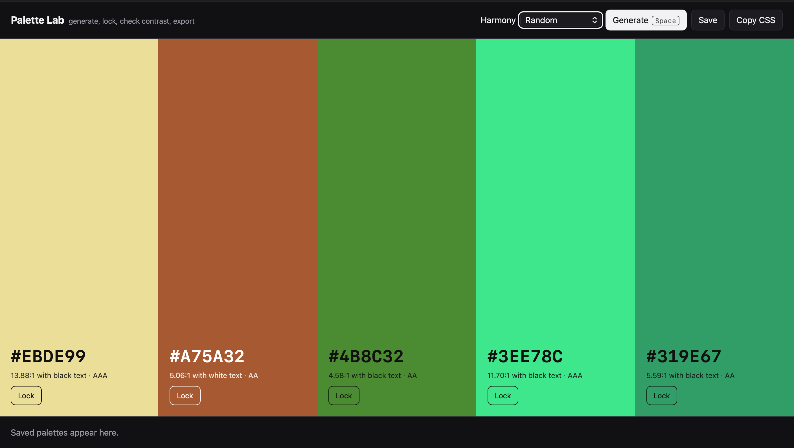

# 🎨 Palette Lab

A fast, accessible color palette generator built with vanilla HTML, CSS and JavaScript. Generate harmonious palettes, lock the colors you like, check WCAG contrast at a glance, and export everything as CSS variables.

**[Live demo](https://wazna02.github.io/palette-lab/)**



## Features

- **Five harmony modes:** analogous, complementary, triad, monochrome and random, generated with HSL color math.
- **Lock colors:** keep the swatches you like and regenerate the rest.
- **WCAG contrast checker:** every swatch shows its contrast ratio and an AA / AAA grade. Text color is chosen automatically for the best readability.
- **One-click export:** click any hex code to copy it, or copy the full palette as CSS custom properties.
- **Saved palettes:** store up to 12 palettes in the browser with `localStorage`.
- **Keyboard friendly:** press `Space` to generate, with visible focus states and ARIA labels throughout.
- **Responsive and theme-aware:** swatches stack on mobile, and the interface follows your light or dark mode.
- **Reduced motion:** transitions are disabled for users who prefer it.

## Tech stack

- HTML5 (semantic markup)
- CSS3 (custom properties, flexbox, media queries)
- Vanilla JavaScript (ES6+), with no frameworks or dependencies

## Getting started

```bash
git clone https://github.com/Wazna02/palette-lab.git
cd palette-lab
```

Then open `index.html` in your browser, or use the Live Server extension in VS Code.

## Project structure

```
palette-lab/
├── index.html    # Markup
├── style.css     # Styles and theme tokens
├── script.js     # Color generation, contrast logic, UI
└── README.md
```

## How it works

- **Color generation:** each mode applies hue offsets around a random base hue, with randomized saturation and lightness, then converts HSL to hex.
- **Contrast:** relative luminance is calculated per the WCAG 2.x formula, and the contrast ratio is `(L1 + 0.05) / (L2 + 0.05)`. The swatch picks white or black text, whichever scores higher.
- **Persistence:** saved palettes are stored as JSON in `localStorage`, wrapped in `try/catch` so the app still works if storage is unavailable.

## What I learned

- Implementing WCAG contrast calculations from the spec
- Building accessible interactive UI: focus management, ARIA attributes, keyboard shortcuts
- Structuring state and rendering without a framework
- Designing for light and dark themes with CSS custom properties

## Roadmap

- [ ] Undo and redo history
- [ ] Shareable palette URLs
- [ ] Extract a palette from an uploaded image
- [ ] Export as JSON, SCSS and Tailwind config

## License

MIT. Free to use and modify.